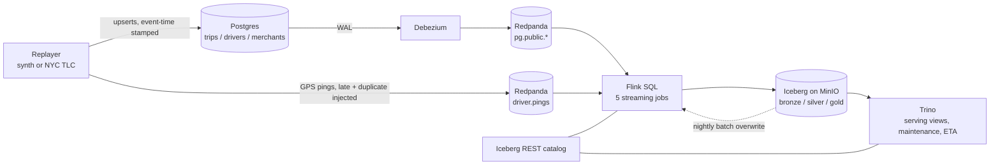

# Real-time Marketplace State & ETA Lakehouse

A local, low-cost lakehouse that replays NYC taxi trips (or a synthetic city) as a live stream,
ingests it with **Debezium CDC from Postgres**, processes it in **Flink SQL**, and writes
**Iceberg** tables on MinIO, queried with **Trino**. Every component is open source and runs
in Docker; no cloud bill.

The point is not the pipeline. The point is the **design reasoning** the pipeline forces:
event time vs processing time, watermarks and late data, exactly-once sinks, idempotent upserts,
H3 geospatial joins, Kappa vs Lambda backfills, SCD2, compaction, and a failure-mode table you
fill in with *observed* results.

> **Windows edition.** Everything is driven by `.\tasks <target>` (PowerShell or cmd). No `make`,
> no bash. Run `.\tasks help` to see all targets.

- Plan and milestones: [docs/PLAN.md](docs/PLAN.md)
- Design doc + failure-mode table: [docs/DESIGN.md](docs/DESIGN.md)
- Experiments runbook: [docs/EXPERIMENTS.md](docs/EXPERIMENTS.md)
- Decisions: [docs/adr/](docs/adr)

## Architecture



| Layer | Table | Shape | Notes |
|---|---|---|---|
| bronze | `cdc_raw` | append | raw Debezium JSON + Kafka coordinates; replay source |
| silver | `trips` | **upsert** (v2, equality deletes) | latest state per trip, H3 cells, actual duration |
| silver | `driver_pings` | append, deduped | keep-first on `(driver_id, seq)`, event-date partitioned |
| silver | `driver_pings_late` | append | pings whose 1-min window had already closed |
| silver | `driver_versions`, `merchant_versions` | append | SCD2 inputs (version logs) |
| gold | `h3_demand_1m`, `h3_supply_1m` | append (windowed) | repaired by batch `INSERT OVERWRITE` |
| serving | `dim_*_scd2`, `v_trips_enriched`, `v_surge_1m` | Trino views | as-of join, surge ratio |

## Prerequisites (Windows 10/11)

| Need | How |
|---|---|
| Docker Desktop (WSL2 backend) | Install from docker.com, reboot if asked. Wait for "Engine running". |
| **12 GB+ memory for Docker** | WSL2 backend: create `%UserProfile%\.wslconfig` containing `[wsl2]` and `memory=12GB` (two lines), then run `wsl --shutdown` and restart Docker Desktop. Machines with 16 GB RAM can do this; 8 GB cannot. |
| Python 3.10+ | python.org installer; tick **"Add python.exe to PATH"**. Check: `py -3 --version` |
| VS Code | Open this folder; accept the "install recommended extensions" prompt. |
| Internet on first `.\tasks up` | Pulls images and downloads connector jars from Maven Central. |

Not needed: `make`, Git Bash, WSL shell, Java, Maven (the UDF is built inside Docker).

## Quick start

Open a terminal in VS Code (**Terminal > New Terminal**, PowerShell) at the project root:

```powershell
.\tasks help                # list every target
.\tasks venv                # create .venv, install replayer + pytest + ruff
.\tasks test                # 18 unit tests, no Docker needed
.\tasks replay-dry          # print 20 fake events to see the stream's shape

.\tasks up                  # build + start the stack (first run: 5-15 minutes)
.\tasks ps                  # wait until everything is Up / healthy
.\tasks init                # waits for services, then topics + Debezium connector + Iceberg tables
.\tasks jobs                # submit the 5 streaming jobs -> http://localhost:8081

.\tasks replay              # 2 simulated hours at 60x (~2 min wall), writes manifest.json
Start-Sleep -Seconds 60     # let Flink complete a couple of checkpoints
.\tasks reconcile           # PASS/FAIL against the replayer's ground truth
.\tasks trino-views
.\tasks trino               # SQL prompt; try:  SELECT count(*) FROM silver.driver_pings;
```

`.\tasks` is `tasks.cmd`, a tiny wrapper that runs `scripts\tasks.ps1` with the execution policy
bypassed for that one process, so you never have to change system settings. In VS Code every
step is also a task: **Terminal > Run Task...**

**One replay per clean stack.** Ping `seq` restarts at 1 every run, so a second replay into the
same lake collides with the first. Use `.\tasks fresh` (= nuke + up + init + jobs) between runs.

Custom replays call Python directly:

```powershell
.\.venv\Scripts\python -m replayer run --speedup 5 --duration-min 120 --seed 42 --manifest manifest.json
```

PowerShell 5.1 has no `&&`. Put commands on separate lines or separate them with `;`.

## Ports

| Service | URL |
|---|---|
| Flink UI | http://localhost:8081 |
| Trino | http://localhost:8080 |
| MinIO console | http://localhost:9001 (minioadmin / minioadmin) |
| Debezium Connect | http://localhost:8083 |
| Iceberg REST catalog | http://localhost:8181 |
| Redpanda Kafka (host) / admin | localhost:19092 / http://localhost:9644 |
| Postgres | localhost:5432 (lakehouse / lakehouse, db `marketplace`) |

## Layout

```
docker-compose.yml          stack
infra/                      postgres init, Debezium connector, Flink image, Trino catalog
udf/                        Java H3 scalar UDF (h3_cell) built into the Flink image
flink/sql/                  init, DDL, 5 streaming jobs, batch reconcile
replayer/                   event generator, TLC loader, late/dup injection, sinks, CLI
tasks.cmd                   the command you type: .\tasks <target>  (replaces make)
scripts/                    tasks.ps1 (the real task runner), reconcile.py, fetch_tlc.py
sql/trino/                  serving views, maintenance, ETA analysis, verification probes
docs/                       plan, design doc, experiments, ADRs
tests/                      pytest (replayer + reconcile logic)
```

## Honest status: what is and isn't verified

Verified: the 18 replayer/reconcile unit tests and lint; the `.\tasks` runner under PowerShell 7.4
with a stubbed `docker` and fake Debezium/Flink/Iceberg HTTP endpoints (help, venv, test, SQL
rendering and placeholder errors, `init` including the Debezium PUT and readiness waits, `jobs`,
`reconcile-gold`, chaos actions, piping SQL into Trino); the Flink SQL columns against the Iceberg
DDL; the Java UDF compiles against stubs.

**Not executed:** the real Docker stack (Flink SQL, Debezium, Trino, the Java UDF build) and the
scripts on real Windows PowerShell 5.1. I wrote them to be 5.1-safe (no `&&`, no `?:`, ASCII only,
BOM-less files, explicit exit-code checks) but you are the first real run. Treat the first
`.\tasks up` as integration testing and expect small fixes (jar URLs, image tags).

## Windows troubleshooting

| Symptom | Fix |
|---|---|
| `Docker is installed but not running` | Start Docker Desktop; wait until it says "Engine running". |
| `.\tasks` says "not recognized" | You are not in the project root. `cd` to the folder that contains `tasks.cmd`. |
| Port 5432 already in use | A local PostgreSQL service is running. Stop it (Services > postgresql) or change `"5432:5432"` in `docker-compose.yml` to `"5433:5432"` and use `--pg-dsn ...localhost:5433...`. |
| Containers killed / jobs stuck `SCHEDULED` / everything very slow | Not enough memory. Set `memory=12GB` in `.wslconfig` (see above); close other heavy apps; stop `trino` when idle. |
| `timed out waiting for http://localhost:8083/connectors` | Containers still starting, or one crashed: `.\tasks ps`, then `.\tasks logs`. |
| `.\tasks venv` finds no Python | Install Python 3.10+ from python.org with "Add to PATH"; reopen the terminal. The Microsoft Store `python` stub is skipped on purpose. |
| `docker build` fails downloading a jar | Version/URL drift: check the `ARG`s in `infra\flink\Dockerfile` against Maven Central. |
| Image tag not found (MinIO, Trino, Redpanda) | Pinned tags age out. Bump to a current tag. |
| Flink `ClassNotFoundException` for Hadoop `Configuration` | Hadoop jar missing/misplaced in `/opt/flink/lib` of the image. |
| Flink cannot parse timestamps from Debezium | Inspect a raw message: `docker compose exec redpanda rpk topic consume pg.public.trips -n 1`. |
| `CREATE FUNCTION` / H3 native library error | UDF jar not in `/opt/flink/lib`, or CPU architecture mismatch (rare on x64 Windows). |
| Trino `CREATE VIEW` fails on the REST catalog | Run the view bodies as plain `SELECT`s instead. |
| Debezium connector `FAILED` | `Invoke-RestMethod http://localhost:8083/connectors/pg-marketplace/status`; usual causes are `wal_level` not `logical` or a stale replication slot. |
| Scripts behave oddly after `git clone` | Line endings. The included `.gitattributes` forces LF; if you cloned before adding it, run `git add --renormalize .`. |
| Antivirus / long-path errors during `docker build` | Keep the project near the drive root (e.g. `C:\projects\...`), and exclude the folder from real-time scanning if builds crawl. |
